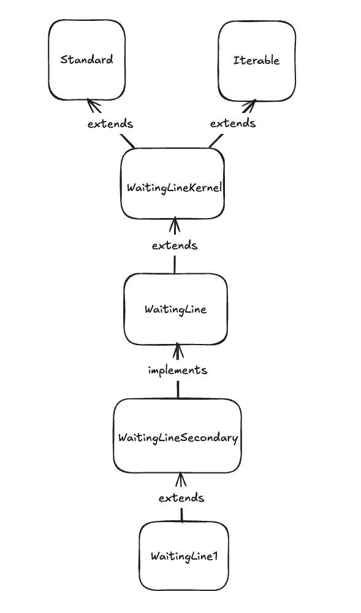

# WaitingLine Design

## Component hierarchy

The kernel extends `Standard<WaitingLine<T>>` and `Iterable<T>`.
The secondary class implements enhanced and Object methods using kernel,
Standard, and Iterable operations. The concrete class implements the kernel
and Standard methods.

## Representation

`WaitingLine1<T>` stores entries in a `Sequence<T>`, initialized as
`Sequence2L<T>`. Sequence order matches waiting order, so entries can be added
at the back, removed from the front, or removed at a specific position without
implementing linked nodes manually.

- **Convention:** the representation and all entries are non-null; no two
  entries are equal according to `equals`.
- **Correspondence:** the abstract waiting line is the representation's entries
  in sequence order, with position zero at the front.

The convention and correspondence also appear in `WaitingLine1.java`.

## Test plan

Tests are in `test/components/waitingline/WaitingLine1Test.java` and
`WaitingLineTest.java`.

| Methods | Cases |
| --- | --- |
| Constructor, length, addToLine, removeFromLine | Empty, singleton, multiple entries, FIFO order, reuse |
| contains, remove | Present/absent entries, first/middle/last positions, remaining order |
| clear, newInstance | Empty/nonempty lines, empty result, independent instances |
| transferFrom | Empty/nonempty source and receiver, replacement, source clearing, independence |
| iterator | Empty/nonempty lines, traversal order, unchanged state, unsupported removal |
| front, pos | Singleton/multiple entries, each position, unchanged state |
| append | Empty/nonempty lines, combined order, source clearing |
| insertAtFront, moveToFront | Empty/singleton/multiple entries, first/middle/last positions, remaining order |
| equals, hashCode, toString | Equal/unequal values, different order/length, null/unrelated objects, text output |
| Preconditions | Null entry, duplicates, missing entries, empty removal/front, self transfer/append, overlapping append |

## Use cases

- `src/HelpDeskDemo.java`: customer arrivals, cancellation, merging lines,
  priority service, and serving customers.
- `src/RoundRobinDemo.java`: players take turns in a game, rejoining the back
  after each turn. Each player gets two turns.
